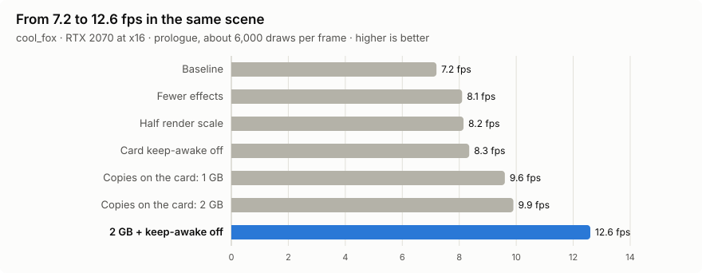
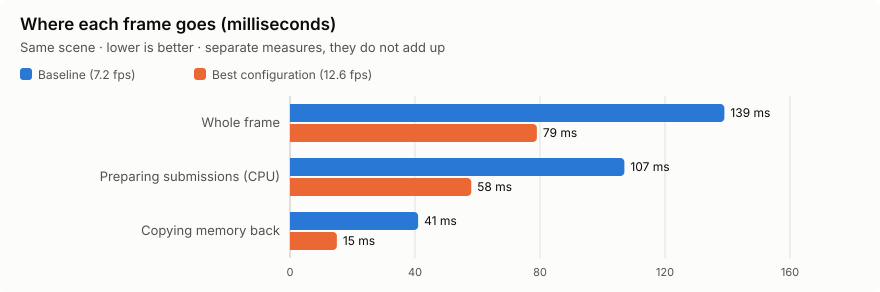
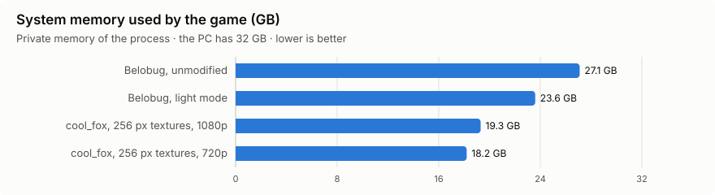
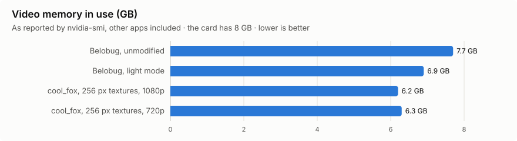

# GTA VI through compatibility layers on an RTX 2070: performance report

Measurements taken on 26 November 2026 on a desktop PC with an 8 GB graphics card. Most of the work is on **cool_fox**, a layer derived from VIctory.

## Summary

- **Best result: 12.6 fps** in the test scene, up from 7.2. A repeat run of the same configuration gave 11.6, so expect about 1 fps of run-to-run variation.
- The two settings that mattered most: **giving buffer copies more video memory** and **turning off the card keep-awake workload**.
- **20 fps was not reached.** The main remaining limit is the CPU work done before each submission to the graphics card.
- The graphics card spent part of the day running at **PCIe x2 instead of x16**. Check this before comparing numbers.
- Belobug's fork was much slower on this machine (0.8 to 2.5 fps).

## Test PC

| Component | Detail |
|---|---|
| Graphics card | NVIDIA GeForce RTX 2070, 8 GB, driver 621.24 |
| CPU | Intel Core i7-11700KF, 8 cores / 16 threads, 3.6 GHz |
| Memory | 32 GB DDR4 at 2400 MHz (16 + 8 + 8 GB modules) |
| Motherboard | MSI MAG Z590 TOMAHAWK WIFI, BIOS 2.90 |
| Drive | Samsung SSD 870 QVO 1 TB (SATA) |
| OS | Windows 11 Pro, build 26300; 80,000 MB page file |
| Graphics link | PCIe 3.0, **x2 at first, x16 by the end of the day** |

## Main result

<picture>
  <source media="(prefers-color-scheme: dark)" srcset="charts/fps-same-scene-dark.svg">
  
</picture>

Every run here shares the same base setup: Series S profile, 720p output through the title's own upscaler, and textures capped at 256 pixels.

### Rounds 1 and 2: each setting and the combinations

| Configuration | fps | Frame (ms) | Preparing (ms) | Copy back (ms) | Draws | Comparable? |
|---|--:|--:|--:|--:|--:|---|
| Baseline | 7.2 | 139 | 107 | 41 | 5,844 | Yes |
| Fewer effects | 8.1 | 124 | 90 | 35 | 5,881 | Yes |
| Half render scale | 8.15 | 123 | 83 | 34 | 6,048 | Yes |
| Card keep-awake off | 8.35 | 120 | 85 | 37 | 6,038 | Yes |
| Buffer copies on the card: 1 GB | 9.6 | 104 | 58 | 14 | 6,009 | Yes |
| Buffer copies on the card: 2 GB | 9.9 | 101 | 76 | 16 | 6,068 | Yes |
| **2 GB + keep-awake off** | **12.6** | **79** | **58** | **15** | 5,984 | Yes |
| Previous + fewer effects + half render scale | 12.6 | 79 | 60 | 15 | 5,697 | Yes |
| 2 GB + keep-awake off + fewer effects | 12.9 | 77 | 55 | 12 | 4,790 | No: fewer draws |

Lowering the render scale or removing effects added nothing clear on top of the two good settings, so both were left out to keep image quality.

### Round 3: attempts on top of the best configuration

| Added change | fps | Draws | Reading |
|---|--:|--:|---|
| None (repeat) | 11.6 | 5,890 | Reference for this round |
| High process priority | 11.5 | 6,127 | No gain |
| 6 copy threads | 11.0 | 7,446 | Heavier scene |
| Every copy on the card | 15.5 | 2,147 | **Not comparable:** much lighter scene |
| 1 GB of memory windows on the card | 10.3 | 7,321 | Heavier scene |
| Fewer steps on the card | 10.3 | 5,888 | Worse |
| 16 joined submissions | 10.8 | 7,301 | Heavier scene |
| GPU timing instrumentation | 5.6 | 7,402 | Instrumentation slows the game |

The timing pass showed no single dominant effect: the GPU cost was spread across many work lists.

## Where the time goes

<picture>
  <source media="(prefers-color-scheme: dark)" srcset="charts/frame-time-dark.svg">
  
</picture>

20 fps needs a 50 ms frame. The best configuration takes 79 ms, and preparing the submissions alone still takes about 58.

## Final configuration

| Setting | Purpose |
|---|---|
| `--console series-s` | The smaller console's profile |
| `VICTORY_OUTPUT=1280x720` | The title renders to a 720p output |
| `VICTORY_UPSCALER=6` | The title's own upscaler instead of AMD's |
| `VICTORY_TEXTURE_MAX=256` | Small textures so they fit in 8 GB (without `VICTORY_LEVELS_ON_DEMAND`) |
| `VICTORY_CARD_BUFFERS_MB=2048` | More buffer copies in video memory (the default here was 512) |
| `VICTORY_CARD_AWAKE=0` | No filler workload to hold the card's clocks up |

<details>
<summary>Full list of variables</summary>

```text
VICTORY_AMBIENT=1.6
VICTORY_AMBIENT_AIR=1.5
VICTORY_ASYNC_SUBMIT=1
VICTORY_CARD_AWAKE=0
VICTORY_CARD_BUFFERS_MB=2048
VICTORY_CARD_BUFFERS_MIN_KB=64
VICTORY_CARD_REHASH_RUNS=1
VICTORY_CARD_STEPS=2
VICTORY_INDIRECT_BATCH=2
VICTORY_INDIRECT_WINDOW=1
VICTORY_JOIN_COPIES=1
VICTORY_JOIN_PARTS=8
VICTORY_MAP_THREADS=1
VICTORY_OUTPUT=1280x720
VICTORY_PIPELINE_BOOK=1
VICTORY_RELAY=2
VICTORY_RELAY_COPY=1
VICTORY_SHOW_AFTER=1
VICTORY_TEXTURE_MAX=256
VICTORY_TEXTURE_NO_WAIT=1
VICTORY_THIN=1
VICTORY_UPLOAD_AHEAD=1
VICTORY_UPSCALER=6
VICTORY_WIDE_BACK=1
```

`VICTORY_TEXTURE_MAX`, `VICTORY_OUTPUT` and `VICTORY_UPSCALER` are not part of stock cool_fox: they were ported from Belobug's fork (see [changes](docs/changes.md)).

</details>

## PCIe: x2 instead of x16

The card supports x16 but was running at x2. During play the measured transfer reached about 2 GB/s, the ceiling of x2. It was fixed by hand on the PC and now runs at x16.

| Scenes above 4,500 draws | x2 | x16 |
|---|--:|--:|
| fps | 5.9 | 7.3 |

The x16 sample is short (under a minute) and the scenes were not identical. The gain was real but smaller than expected.

To check another NVIDIA PC, run this while a game is running:

```powershell
nvidia-smi --query-gpu=pcie.link.width.current --format=csv
```

## Progress over the day

Manual play sessions. **They are not comparable with each other** except where noted: scenes, build and PCIe link change.

| cool_fox step | PCIe | fps |
|---|---|--:|
| Stock Series S | x2 | 2.3 – 2.4 |
| FSR4 neural network skipped | x2 | 6.3 |
| FSR4 replaced by a plain upscale | x2 | 7.0 |
| Previous + async submit | x2 | 7.7 |
| 256 px textures at 1080p | x2 | 7.2 |
| 256 px textures at 720p (against 7.0 at 1080p in similar scenes) | x2 | ~10 |

In the stock run, about 330 of the 455 ms of GPU time per frame went into the FSR4 network, which uses matrix operations the RTX 2070 has to emulate.

## Memory

<picture>
  <source media="(prefers-color-scheme: dark)" srcset="charts/memory-ram-dark.svg">
  
</picture>

<picture>
  <source media="(prefers-color-scheme: dark)" srcset="charts/memory-vram-dark.svg">
  
</picture>

With textures capped at 256 pixels they looked right to the eye and loaded instead of staying black. No long session has been played with the final configuration (more copies on the card).

## Other projects on this PC

| Project | Conditions | fps | Notes |
|---|---|--:|---|
| Belobug, unmodified `a-publier` branch | Its own launcher, x2 | ~1 | Still building pipelines; 27 GB of RAM and video memory full |
| Belobug, light mode | Settings only, x2 | 2 – 2.5 | Series S, 720p, 256 px textures |
| Belobug, light mode + the two settings | Automated run, x16 | 0.8 | Scene with about 10,400 draws |
| Belobug with its five renderer patches | Automated run, x16 | no data | Stopped before the valid measurement |
| Kelvaroq | Series X, first session, x2 | 2 – 3 | Picture mostly black, during first-time compilation |

Belobug's `main` branch, with a local fix for NVIDIA's descriptor heap limit, crashed at start-up inside `nvwgf2umx.dll`. It started with `VICTORY_FPS=0`, `VICTORY_ASYNC_SUBMIT=0`, `VICTORY_STRETCH=0` and `VICTORY_HOIST_CLAMPS=0`; which of the four was the cause was not isolated.

## Method and limits

- **Automated run:** cool_fox's diagnostics build with scripted key presses (`VICTORY_KEYS`) to enter the story on its own. Measured from 20 s after the first heavy frame, for about 55 to 75 s.
- Each figure is the **median** of the performance lines the layer writes (one about every 5 s): 11 to 15 samples.
- **One run per configuration.** The only repeat differed by 1 fps.
- This is the **opening scene**. Heavier areas run slower and menus reach 30 fps.
- The release build has not been measured with the final configuration.
- Everything comes from **one PC**.

The data is in [`data/`](data/). To rebuild the charts:

```powershell
python tools/make_charts.py
```

## Notice

This repository contains measurements and descriptions only. **It includes no game files, no game code, no links to obtain the game, and no compatibility layer code.** It is not affiliated with Rockstar Games, Take-Two, Microsoft, NVIDIA or the authors of the projects mentioned. Using unauthorised copies of a game is copyright infringement.

Projects mentioned: VIctory (Marvisak), cool_fox (codec-d; its repository is no longer available), VIctory-Belobug-AMD (Belobug), VIctory-7900XTX (avatarmanz) and Kelvaroq (stellarr-studio).

The tests and this report were produced with the help of Claude Code.
